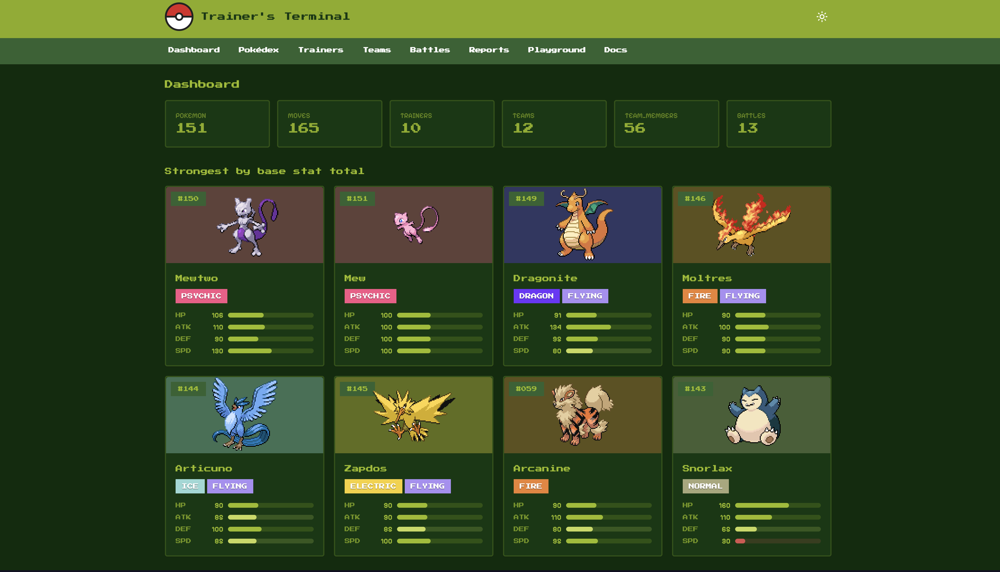
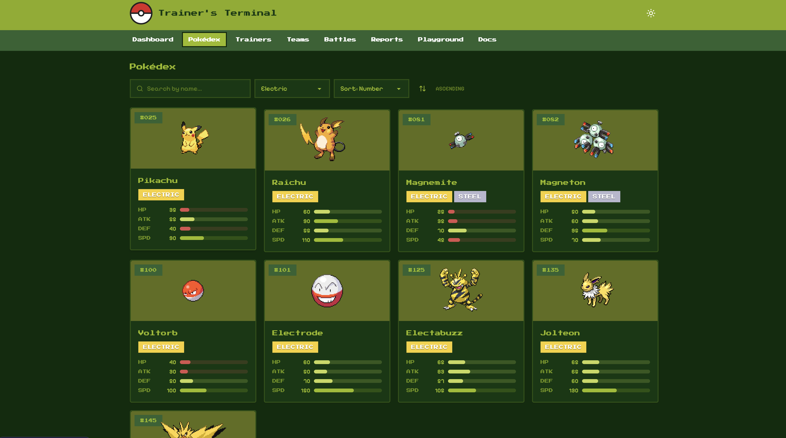
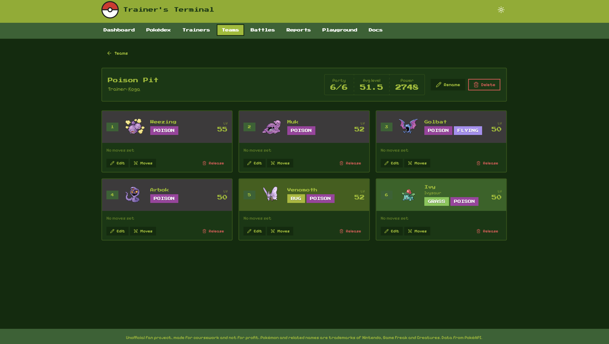
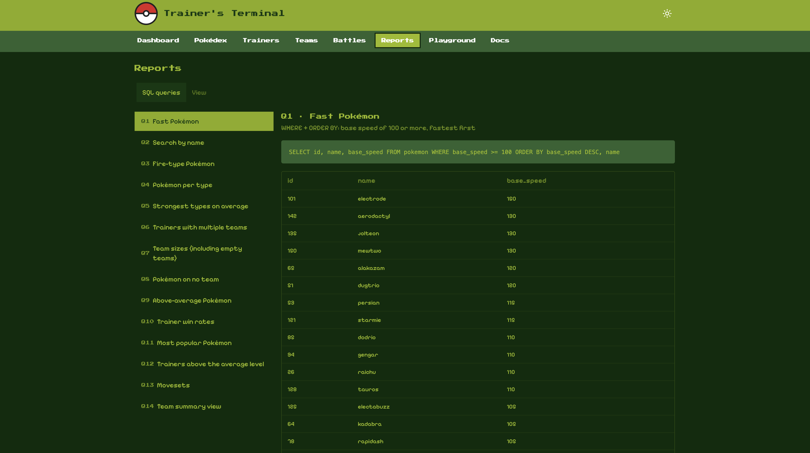
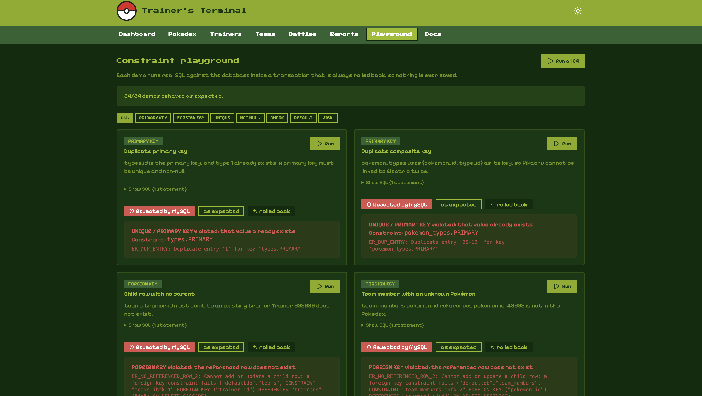
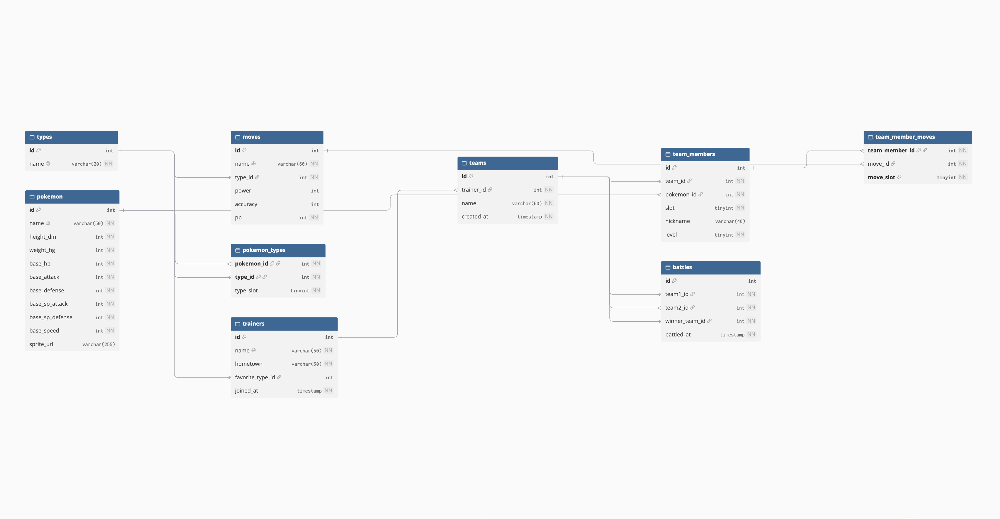

# Trainer's Terminal

An unofficial Pokémon team builder and trainer manager, built as a database coursework project. Browse the original 151 Pokémon, register trainers, build six-slot teams with movesets, log battles, and watch a MySQL schema enforce its own rules.

The app is a window onto the database. Every feature maps to something in the schema: constraints, joins, aggregates, a view, and cascading deletes are all visible and runnable from the UI.



## Features

- **Pokédex:** search, filter by type, sort by any stat, paginate, and view detail pages with radar charts.
- **Trainers, teams, and battles:** full create, view, update, and delete with search, filters, and sorting.
- **Team builder:** a six-slot party with nicknames, levels, and up to four moves per Pokémon.
- **Reports:** 14 labelled SQL queries, each showing its SQL and its live result.
- **View:** the `v_team_summary` definition (read live via `SHOW CREATE VIEW`) and its rows.
- **Constraint playground:** 24 demos that trigger PRIMARY KEY, FOREIGN KEY, UNIQUE, NOT NULL, CHECK, DEFAULT, and view behaviour. Every demo runs in a transaction that is always rolled back.
- **Docs page:** requirements checklist, ER diagram, live row counts, functional dependencies, and the 1NF to 3NF justification.
- **Themes:** a Pokédex light theme and a Game Boy dark theme.

## Tech stack

| Layer | Tools |
|---|---|
| Database | MySQL 8.0.16 or later (hosted on Aiven) |
| Backend | Node.js, Express, `mysql2` |
| Frontend | React, Vite, Tailwind CSS v4, daisyUI, React Router, Recharts |
| Data source | [PokéAPI](https://pokeapi.co), seeded once into the database |

## Screenshots

| Pokédex | Team builder |
|---|---|
|  |  |

| Reports | Constraint playground |
|---|---|
|  |  |

## Getting started

### Prerequisites

- Node.js 20.19+ or 22+
- A MySQL **8.0.16 or newer** database. Older versions parse CHECK constraints but silently ignore them. I used an Aiven free-tier MySQL service, but any MySQL 8 works.
- Internet access for the first seed (to call PokéAPI) and for the Google Fonts and sprite images.

### 1. Clone and install

```bash
git clone https://github.com/JimMilton1900/poketrainer.git
cd poketrainer

cd backend && npm install
cd ../frontend && npm install
```

### 2. Configure the database connection

```bash
cd backend
cp .env.example .env
```

Edit `backend/.env`:

```
DB_HOST=your-service.aivencloud.com
DB_PORT=12345
DB_USER=avnadmin
DB_PASSWORD=your-password
DB_NAME=defaultdb
PORT=3000
```

Never commit `.env`. It is listed in `.gitignore`.

### 3. Create the schema and load data

Run these from `backend/`, in this order:

```bash
npm run schema   # creates the 9 tables and the CHECK constraints
npm run seed     # fetches Pokémon, types and moves from PokéAPI (about 2 minutes the first time, cached afterwards)
npm run sample   # inserts demo trainers, teams, battles, and creates the view
npm run verify   # optional: sanity-checks the seeded data
```

Notes:

- `npm run seed` is safe to repeat, because it upserts the reference data and never touches trainers or teams.
- `npm run sample` is **one-time**, for empty user tables. Running it twice fails on duplicate trainer names. To start over, run `npm run reset`, then the three commands above.
- Reports and playground demos look rows up by name (Ash, Kanto Journey, and so on), so keep the sample data if you want them to work.

### 4. Run the app

Use two terminals:

```bash
# Terminal 1: API on http://localhost:3000
cd backend
npm start

# Terminal 2: UI on http://localhost:5173
cd frontend
npm run dev
```

Open **http://localhost:5173**. Vite proxies `/api` to Express, so there is no CORS setup. If you change the API port, update the proxy target in `frontend/vite.config.js`.

## Using the app

1. **Dashboard** shows live row counts and the strongest Pokémon.
2. **Trainers** is where you create one. Try a duplicate name and watch the UNIQUE error appear inside the form.
3. **Teams** is for creating a team for that trainer. Open it and click an empty slot to add Pokémon, set nicknames and levels, and assign up to four moves.
4. **Battles** is for recording a battle between two teams. A team cannot fight itself, and the winner must be a participant.
5. **Reports** runs the 14 queries and the view.
6. **Playground** has a **Run all** button, which should report 24/24 demos behaving as expected.
7. **Docs** has the normalization write-up and the ER diagram.

## Database design

Nine tables in two groups:

- **Reference data (from PokéAPI):** `types`, `pokemon`, `pokemon_types`, `moves`
- **User data:** `trainers`, `teams`, `team_members`, `team_member_moves`, `battles`



The ownership chain is trainer → teams → team members → moves. Deleting a trainer cascades down it. Anything with battle history, and any Pokémon on a team, is protected by `ON DELETE RESTRICT`. (check backend/sql/01_schema.sql)

| Requirement | Where it lives |
|---|---|
| 5+ related tables | 9 tables, see the ER diagram |
| PK, FK, NOT NULL, UNIQUE, CHECK, DEFAULT | `backend/sql/01_schema.sql`, `02_checks.sql`, live in the Playground |
| Normalization to 3NF | Docs page in the app |
| 10+ rows per main table | `04_sample_data.sql` and the PokéAPI seed |
| 10+ queries (WHERE, ORDER BY, GROUP BY/HAVING, aggregates, joins, subqueries) | `backend/sql/queries.sql`, Reports page |
| View | `v_team_summary` in `backend/sql/05_view.sql` |
| Add, view, update, delete, search, report | Trainers, Teams, Battles, Pokédex, Reports |

## Project structure

```
.
├─ backend/
│  ├─ seed/                     PokéAPI seeding script
│  ├─ sql/                      schema, checks, sample data, view, queries, verify
│  ├─ src/                      source files for backend
│      ├─ config/               configuration files/connection pool for Aiven server
│      ├─ middleware/           error handling middleware
│      ├─ routes/               HTTP routes for server interaction
│      ├─ sql/                  report queries
│      ├─ constraintDemos.js    Constraint demo data
│      ├─ server.js             Express erver
│      ├─ utils.js              utility files for server functioning
│      ├─ *.http                REST Client request collections
├─ frontend/
│  └─ src/
│     ├─ pages/             one file per screen
│     ├─ components/        shared UI (modals, cards, pagination, ...)
│     └─ hooks/, utils/, api.js
└─ docs/                    screenshots and ER diagram
```

## API overview

All routes are under `/api`. List endpoints return `{ page, limit, total, data }` and accept `search`, `sort`, `order`, `page`, `limit`, plus resource-specific filters.

| Resource | Endpoints |
|---|---|
| Pokémon | `GET /pokemon`, `GET /pokemon/:id` |
| Trainers, teams, battles | `GET`, `POST`, `PUT /:id`, `DELETE /:id` |
| Team members | same, plus `PUT /team-members/:id/moves` |
| Reports and views | `GET /reports`, `GET /reports/:id`, `GET /views/:name` |
| Playground | `GET /constraints`, `POST /constraints/:id/run`, `POST /constraints/run-all` |
| Lookups | `GET /types`, `GET /moves`, `GET /stats` |

Open `backend/test.http` in VS Code with the REST Client extension to try every endpoint, including the constraint failures.

All SQL is parameterized, and sort columns are whitelisted. Validation rules (level range, slot range, and so on) are deliberately left to MySQL, so errors reach the UI exactly as the database reports them.

## Troubleshooting

| Problem | Fix |
|---|---|
| `Cannot reach the API` in the UI | Start the backend, and check that the port matches `vite.config.js` |
| `ECONNREFUSED` or SSL errors | Check `.env`, and that your database allows connections from your IP |
| CHECK constraints don't reject bad data | Your MySQL is older than 8.0.16 |
| `Table already exists` | Run `npm run reset` instead of `npm run schema` |
| Duplicate entry on `npm run sample` | Sample data was already loaded. Run `npm run reset` first |
| Playground demo shows "NOT as expected" | Sample data was renamed or deleted, or `02_checks.sql` didn't run |
| Favicon or fonts not updating | Hard refresh (Ctrl+Shift+R) |

## Disclaimer

Unofficial fan project, made for coursework and not for profit. Pokémon and related names, sprites, and artwork are trademarks and copyright of Nintendo, Game Freak, and Creatures Inc. This project is not affiliated with or endorsed by them. Data and sprite URLs come from [PokéAPI](https://pokeapi.co), and no Pokémon image files are stored in this repository.

The constraint playground executes server-defined SQL with no authentication. This is intended for a local demo and is not production-ready.

